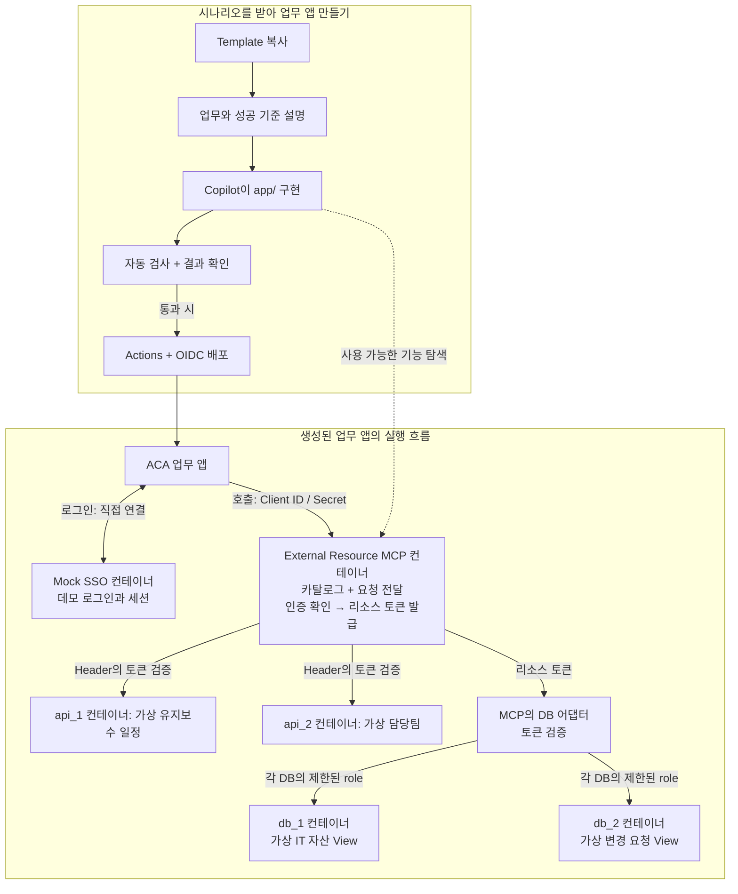

# 구성과 실행 흐름

**템플릿에는 준비된 Mock 서버와 업무 기능 없는 Next.js/React `app/` 실행 골격이 있습니다.**
업무 기능과 Unit은 프롬프트를 받은 뒤 `app/`의 기능별 하위 모듈에 나란히 추가합니다.
Next.js 표준 라우트는 패키지 내부 `app/app/`의 `page.tsx`, `layout.tsx`, `route.ts`에 두고 Unit도 옆에 둡니다.
공통 UI는 승인된 `@hy2219/custom-ui/react` 컴포넌트를 직접 사용하며 HTML 문자열을 React로 감싸지 않습니다.
MCP와 SSO를 호출하는 코드, 세션과 비밀값은 서버 경계에만 두고 Client Component에 전달하지 않습니다.
필요한 Integration만 별도 `app/integration/`에 둡니다.
루트 구조는 `app/`, `mcp/`, `sso/`, `external_resources/`이며 모두 독립 빌드합니다.

## 역할

| 구성 | 동작 |
|---|---|
| External Resource MCP | 같은 도구 정의로 목록과 호출 제공, 앱 인증과 리소스 토큰 발급 |
| `external_resources/api_1`, `api_2` | 각각 독립 API 컨테이너에서 합성 유지보수 일정과 담당팀 반환 |
| `db_1`, `db_2` | 독립 PostgreSQL 컨테이너와 저장 볼륨, 각각 합성 자산과 변경 요청 View만 제공 |
| Mock SSO | 앱과 직접 연결하여 데모 로그인 세션 생성, MCP를 거치지 않음 |
| `app/` | Next.js Server Component/Route Handler로 업무를 구현하고 공식 React 공통 UI 사용, 인증값은 서버에만 유지 |

DB 토큰은 MCP의 DB 어댑터가 검증합니다. PostgreSQL에는 `demo_reader`로 접속하여
사전에 정의한 View만 읽으며, 두 DB 사이에 테이블이나 외래 키를 공유하지 않습니다.
토큰이 없거나 대상과 권한이 맞지 않으면 요청을 거부합니다.

배포용 OIDC, 앱의 Client ID/Secret, 사용자 로그인 세션은 서로 다른 인증입니다.
실제 고객 시스템이나 회사 계정은 연결하지 않습니다.

## Azure 네트워크 배치

Terraform은 VNet 안에 frontend(App/SSO), mcp(runtime), resources(API/DB) 전용 서브넷과 ACA 환경을 분리한다.
NSG는 frontend→resources 직접 통신을 차단하고 frontend→MCP HTTPS, MCP→리소스의 필요한 포트만 허용하도록 구성한다.
MCP/리소스 환경은 내부 Load Balancer와 Private DNS를 사용하고 App만 인터넷에 공개한다.
SSO는 같은 frontend 환경에서 앱과 직접 연결한다. 기존 토큰 검증과 DB View 권한도 유지한다.
로컬 Compose는 이 서브넷 경계를 재현하지 않으며 실제 Azure 배포 후 네트워크 차단을 확인해야 한다.
VNet 없는 기존 환경은 자동 교체하지 않는다. 이전과 추가 비용은 [Azure 구성](../infra/README.md)을 확인한다.

[시작 방법](../README.md) | [리소스 실행과 테스트](../external_resources/README.md) | [Azure 구성](../infra/README.md)
