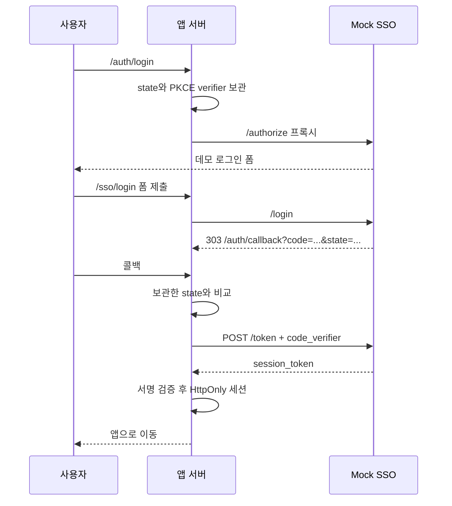

# Mock SSO 연동 계약

**로그인을 구현하는 에이전트는 이 문서를 먼저 읽습니다.**
SSO는 앱과 직접 연결하며 MCP를 거치지 않습니다. 기본 `app/`에는 아직 로그인 기능이 없습니다.
실제 회사 계정은 사용하지 않으며 데모 계정은 `demo / demo1234`입니다.

## 앱에서 사용할 설정

| 설정 | 용도 |
|---|---|
| `SSO_URL` | 서버 간 접속 주소. Compose: `http://sso:8080`, Azure: `http://sso` |
| `APP_CLIENT_ID` | 이 앱과 SSO가 사용하는 동일한 식별자 |
| `SSO_SESSION_KEY` | 데모 로그인 세션의 서명을 검증할 서버 전용 키 |

로컬에서 SSO 자체는 `http://localhost:3102`에 있습니다.
브라우저에는 내부 주소나 서명키를 넘기지 않습니다. SSO는 `APP_CLIENT_SECRET`을 받지 않습니다.
이 키 공유 방식은 **Mock 실습용**이며 실제 회사 SSO/OIDC 서비스가 아닙니다.

## 앱이 구현할 경로

| 앱 경로 | 구현 |
|---|---|
| `GET /auth/login` | state와 PKCE 생성 후 `/sso/authorize`로 이동 |
| `GET /sso/authorize` | 쿼리를 유지하여 SSO의 `/authorize`로 전달, 로그인 HTML 반환 |
| `POST /sso/login` | 폼을 SSO의 `/login`으로 전달, 303 콜백 이동 유지 |
| `GET /sso/theme.css` | SSO의 `/theme.css` 전달 |
| `GET /auth/callback` | state 확인, 서버에서 코드 교환, 토큰 검증 후 세션 저장 |
| `POST /auth/logout` | 앱의 세션과 진행 중인 로그인 상태 삭제 |

HTML의 폼과 CSS 주소는 `login`, `theme.css`라는 상대 경로입니다.
브라우저가 `/sso/authorize`에 있어야 앱 프록시 경로로 이어집니다.
로그인 폼을 직접 만들거나 비밀번호를 앱에 별도 저장할 필요가 없습니다.



## 1. 로그인 시작

Node.js의 `randomBytes(32).toString("hex")`로 64자리 `state`,
`randomBytes(32).toString("base64url")`로 43자리 `code_verifier`를 생성합니다.
`code_challenge`는 verifier 문자열의 SHA-256을 base64url로 인코딩합니다.
state와 verifier는 **해당 브라우저의 일회성 로그인 상태**에 짧게 보관합니다.
서버 저장소나 변조 방지된 HttpOnly 쿠키를 사용하며 URL에 verifier를 넣지 않습니다.

`GET /authorize`의 필수 쿼리:

| 이름 | 값 |
|---|---|
| `client_id` | `APP_CLIENT_ID` |
| `redirect_uri` | 정확히 `/auth/callback` |
| `state` | 위에서 생성한 64자리 16진수 |
| `code_challenge` | 위에서 생성한 43자리 challenge |
| `code_challenge_method` | `S256` |

추가 필드나 임의 redirect 주소는 허용하지 않습니다. 폼이 이 값들을 숨김 필드로 전달합니다.
성공한 로그인 응답은 `303`, `Location: /auth/callback?code=<64자리-코드>&state=<원래-state>`입니다.
앱은 303을 서버에서 따라가지 않고 브라우저의 **앱 콜백**으로 이동시킵니다.

## 2. 콜백과 토큰 교환

먼저 보관한 state와 콜백의 state를 비교합니다. 상태가 없거나 일치하지 않으면 거부합니다.
브라우저에서 받은 code를 다음 값과 함께 **앱 서버에서** `SSO_URL/token`에 POST합니다.
`Content-Type: application/json` 또는 `application/x-www-form-urlencoded`를 지원합니다.

```json
{
  "client_id": "<APP_CLIENT_ID>",
  "code": "<콜백에서 받은 64자리 코드>",
  "redirect_uri": "/auth/callback",
  "code_verifier": "<해당 로그인에서 보관한 43자리 verifier>",
  "grant_type": "authorization_code"
}
```

성공 응답:

```json
{ "session_token": "<서명된 JWT>", "expires_in": 900 }
```

`access_token`이나 `id_token` 필드는 없습니다. 인가 코드는 **한 번만 교환 가능**하며 60초 후 만료됩니다.
동일 코드를 재시도하거나 새로운 verifier로 교환하지 않습니다.

## 3. 세션 검증과 로그아웃

`session_token`을 단순 decode하지 말고 서명을 검증합니다.
검증값은 알고리즘 `HS256`, issuer `simplified-sdlc-sso`, audience `APP_CLIENT_ID`,
subject `demo`, 필수 claim `exp`, `iat`, `jti`입니다. 사용자 정보는 `name="Demo User"`, `mock=true`입니다.
세션 유효기간은 15분이며 앱은 모든 보호된 요청에서 서명과 만료를 확인합니다.

검증한 세션은 HttpOnly, SameSite 쿠키로 관리하고 HTTPS에서는 Secure를 설정합니다.
브라우저의 localStorage에 토큰이나 키를 저장하지 않습니다. 세션 수명은 토큰 만료를 넘기지 않습니다.
콜백 처리가 끝나면 진행 중인 로그인 상태를 지우고 콜백 URL의 code도 화면 주소에서 제거합니다.

로그아웃은 **앱의 책임**입니다. 같은 쿠키 경로와 속성으로 세션 쿠키와 로그인 상태를 삭제하고,
서버에 세션을 저장했다면 해당 세션도 제거합니다. POST 로그아웃에는 CSRF/Origin 방어를 적용합니다.
브라우저 폼이 있는 일반 페이지는 `Referrer-Policy: same-origin`을 사용합니다. 전역 `no-referrer`는
일부 브라우저의 폼 POST에서 `Origin: null`을 만들어 정상 로그인/로그아웃도 거부하게 할 수 있습니다.
코드가 있는 인증 콜백 응답에만 `no-referrer`를 적용하고 즉시 코드 없는 앱 URL로 이동합니다.
로컬 Compose는 HTTP용 `NODE_ENV=development`, ACA 이미지는 HTTPS용 production과 Secure 쿠키를 사용합니다.
SSO 서버에는 `/logout`이나 토큰 취소 API가 없습니다. 쿠키 삭제가 발급된 JWT의 전역 취소를 의미하지는 않습니다.
로그인 세션과 MCP 업무 리소스 토큰은 서로 대체할 수 없습니다.

## 오류 처리와 완료 기준

| 상태 | 의미와 앱 처리 |
|---|---|
| `400` | 누락되거나 잘못된 입력. 요청 구성을 수정하고 오류 안내 |
| `401` | 잘못된 데모 계정, PKCE 불일치, 사용했거나 만료된 코드. 필요하면 새 로그인 시작 |
| `413` | 16 KB 요청 한도 초과 |
| `429` | 미처리 로그인 코드가 너무 많음. 잠시 후 새 로그인 |
| `500` / 연결 실패 | 서버 오류로 표시. 성공 세션으로 대체하지 않음 |

오류 응답은 `{ "error": "..." }`입니다. 코드, 비밀번호, 세션 토큰, 서명키를 로그에 남기지 않습니다.
구현 후 앱 테스트에서 정상 로그인/로그아웃, state 불일치, PKCE 실패, 코드 재사용과 만료,
변조되거나 만료된 세션, 미로그인 접근 거부를 확인합니다.

SSO 자체 테스트: `bun run --cwd sso test`, 컨테이너 실행 후 `bun run --cwd sso test:container`.
